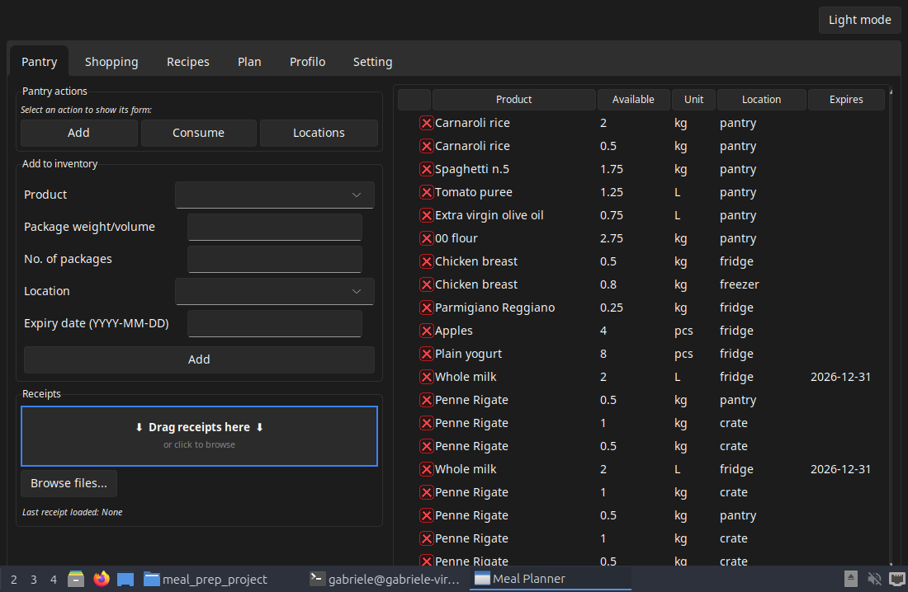
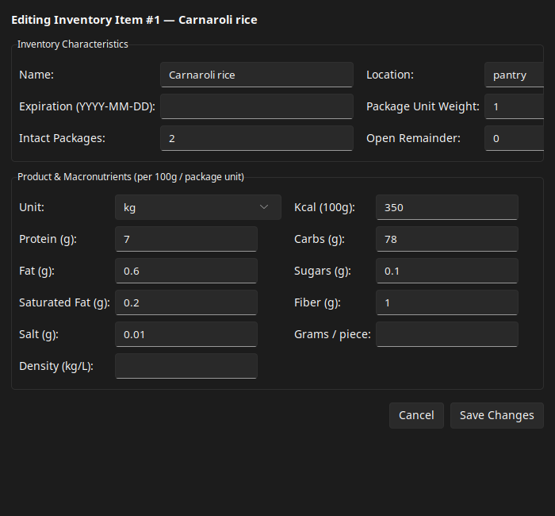
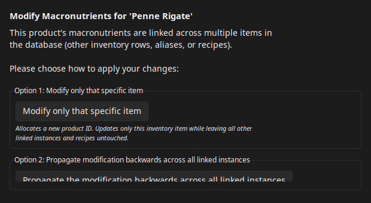
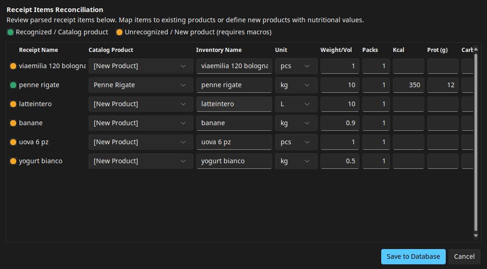
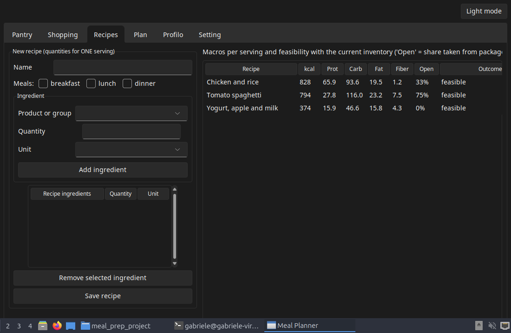
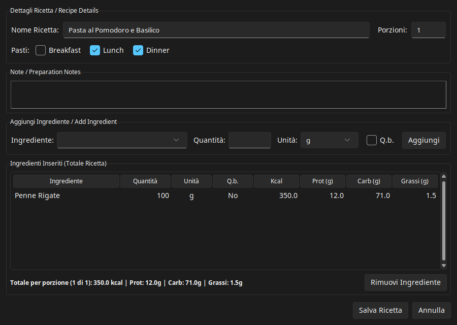
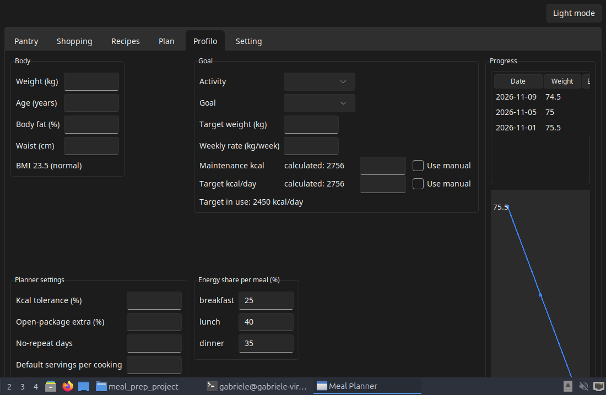
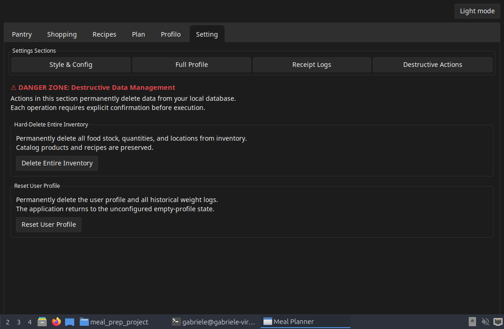
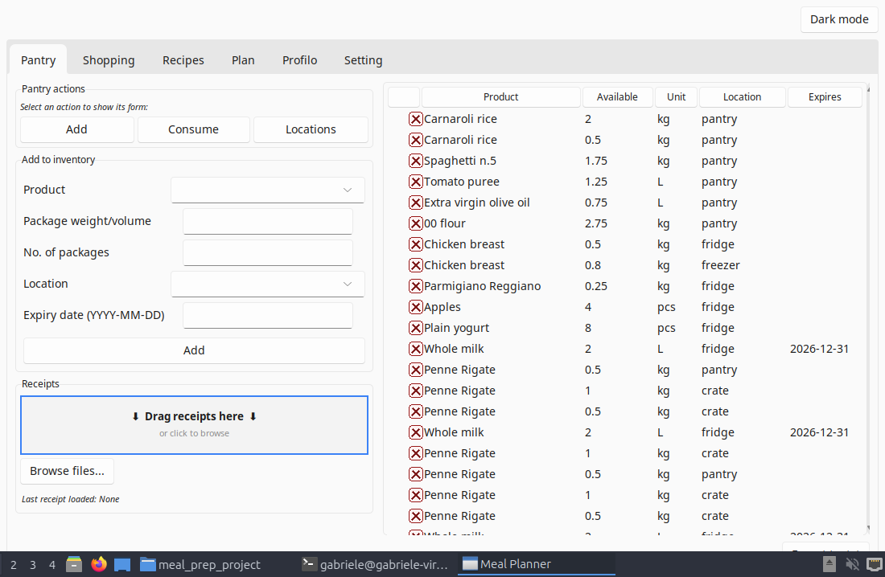

# Guida Completa al Funzionamento di Meal Planner

Benvenuto nel manuale operativo e architetturale di **Meal Planner**, l'applicazione desktop avanzata per la gestione intelligente della dispensa, la catalogazione delle ricette, l'acquisizione automatica degli scontrini e la pianificazione nutrizionale dei pasti a spreco zero.

---

## Indice dei Contenuti
1. [Architettura del Sistema e Avvio](#1-architettura-del-sistema-e-avvio)
2. [Gestione della Dispensa (Scheda Pantry)](#2-gestione-della-dispensa-scheda-pantry)
3. [Modifica di un Alimento e Disambiguazione Macro](#3-modifica-di-un-alimento-e-disambiguazione-macro)
4. [Acquisizione Scontrini e Riconciliazione Catalogo](#4-acquisizione-scontrini-e-riconciliazione-catalogo)
5. [Gestione Ricette e Creazione Interattiva (Scheda Recipes)](#5-gestione-ricette-e-creazione-interattiva-scheda-recipes)
6. [Registrazione di Prodotti al Volo](#6-registrazione-di-prodotti-al-volo)
7. [Pianificatore Alimentare Nutrizionale (Scheda Plan)](#7-pianificatore-alimentare-nutrizionale-scheda-plan)
8. [Lista della Spesa Intelligente (Scheda Shopping)](#8-lista-della-spesa-intelligente-scheda-shopping)
9. [Profilo Utente e Obiettivi Fisici (Scheda Profilo)](#9-profilo-utente-e-obiettivi-fisici-scheda-profilo)
10. [Impostazioni di Sistema e Configurazione (Scheda Setting)](#10-impostazioni-di-sistema-e-configurazione-scheda-setting)
11. [Gestione Temi Grafici (Dark Mode vs Light Mode)](#11-gestione-temi-grafici-dark-mode-vs-light-mode)
12. [Script di Utilità e Strumenti di Sviluppo](#12-script-di-utilità-e-strumenti-di-sviluppo)
13. [Architettura delle Prestazioni e Ottimizzazioni di Sistema](#13-architettura-delle-prestazioni-e-ottimizzazioni-di-sistema)

---

## 1. Architettura del Sistema e Avvio

Meal Planner è concepito secondo i più rigorosi principi di **affidabilità**, **integrità dei dati** e **funzionamento al 100% offline**:
- **Database Centralizzato SQLite**: Tutti i dati (prodotti, alias, scorte fisiche, ricette, storico pesate, log scontrini e impostazioni applicative) risiedono all'interno dell'archivio unico [`data/inventory.db`](file:///home/gabriele/Desktop/meal_prep/meal_prep_project/data/inventory.db).
- **Zero File JSON Sparsi**: Tutte le configurazioni sono gestite all'interno della tabella relazionale `APP_SETTINGS`.
- **WAL Mode & Foreign Keys**: SQLite opera con Write-Ahead Logging (`PRAGMA journal_mode = WAL;`) per garantire massima concorrenza e prestazioni, e vincoli di integrità referenziale sempre attivi (`PRAGMA foreign_keys = ON;`).
- **Interfaccia Grafica**: Costruita con Python Tkinter e il tema moderno `sv-ttk`.

### Come avviare l'applicazione:
Dal terminale nella radice del progetto:
```bash
python -m meal_planner
```
Oppure specificando un database alternativo:
```bash
MEAL_PLANNER_DB=/percorso/mio_archivio.db python -m meal_planner
```

---

## 2. Gestione della Dispensa (Scheda Pantry)

La scheda **Pantry** rappresenta il cruscotto centrale delle scorte alimentari presenti in casa.



### Elementi Principali:
1. **Tabella Scorte dell'Inventario**:
   - Mostra tutti gli alimenti con le relative colonne: **Nome Alimento**, **Unità**, **Quantità Rimanente**, **Locazione** (`pantry`, `fridge`, `freezer`) e **Data di Scadenza**.
   - Gli alimenti vicini alla data di scadenza vengono evidenziati graficamente per prevenire lo spreco.
2. **Pulsante di Eliminazione Dedicato su Ogni Riga (Badge Soft Antialiased)**:
   - All'estremità destra di ciascuna riga è presente un badge personalizzato con icona a croce racchiusa in un quadrato con angoli arrotondati.
   - **Rendering Antialiased ad Alta Definizione**: Disegnato tramite supersampling 4x con ricampionamento sincrono Pillow Lanczos, eliminando artefatti visivi o scalettature.
   - **Palette Soft Coral/Rose Naturale**: Adotta tonalità moderne perfettamente accordate ai temi dell'applicazione, evitando stacchi di colore aggressivi:
     - *Dark Mode*: badge con sfondo `#2d1f22`, bordo `#52272e` e croce soft rose `#f87171`.
     - *Light Mode*: badge con sfondo `#fbebec`, bordo `#f0b8bd` e croce soft coral `#c94a53`.
   - **Persistenza al Cambio Tema**: Il componente aggiorna dinamicamente i riferimenti grafici su tutte le righe della tabella al passaggio da dark a light mode, assicurando che le icone non scompaiano mai visivamente dalla finestra.
   - Cliccando sul pulsante viene richiesta una conferma rapida per rimuovere la singola voce fisica dall'inventario, senza intaccare il catalogo generale dei prodotti o le ricette.
3. **Pannello delle Azioni Rapide**:
   - **Add to inventory**: Form rapido per inserire manualmente un alimento conosciuto.
   - **Consume**: Form per consumare una porzione o quantità specifica di un alimento.
   - **Locations**: Gestione e rinomina delle locazioni di stoccaggio.
4. **Area Drag & Drop per Scontrini**:
   - In basso a destra è presente una zona tratteggiata (*"Drag & drop receipt image or PDF here"*). Rilasciando un'immagine o file di scontrino, la pipeline OCR si attiva istantaneamente.

---

## 3. Modifica di un Alimento e Disambiguazione Macro

Facendo **doppio clic su qualsiasi riga dell'inventario**, si apre la finestra modale di modifica avanzata [`InventoryItemEditDialog`](file:///home/gabriele/Desktop/meal_prep/meal_prep_project/meal_planner/gui/dialogs.py).



### Caratteristiche Modificabili:
- **Dati Fisici di Scorta**: Nome, Peso unitario (es. 0.5 kg per pacco), Numero di confezioni integre, Rimanenza aperta, Locazione e Data di scadenza.
- **Parametri di Prodotto**: Unità di misura (`kg`, `g`, `L`, `ml`, `pcs`), Grammi per pezzo (per i prodotti venduti a unità), Densità in kg/L (per i liquidi).
- **Profilo Nutrizionale Completo (su 100g)**: Calorie (Kcal), Proteine, Carboidrati, Grassi, Zuccheri, Grassi Saturi, Fibre e Sale.

### Prompt di Scelta per la Propagazione dei Macronutrienti:
Se i valori nutrizionali modificati appartengono a un prodotto condiviso da più voci d'inventario o ricette, il sistema protegge la coerenza dell'archivio aprendo un prompt di decisione:



L'utente può scegliere tra due comportamenti espliciti:
1. **Modifica solo questo alimento specifico (Opzione 1)**: Crea un nuovo prodotto derivato nel catalogo e ri-collega solo l'alimento selezionato, lasciando invariate le altre voci d'inventario e ricette.
2. **Propaga la modifica a ritroso su tutte le istanze collegate (Opzione 2)**: Aggiorna il prodotto madre nel database, propagando i nuovi valori nutrizionali a ritroso su tutti gli alias e le ricette che contengono quell'alimento.

---

## 4. Acquisizione Scontrini e Riconciliazione Catalogo

Trascinando uno scontrino nell'area Drag & Drop o avviando la scansione, il sistema analizza il documento ed apre la finestra di **Riconciliazione Scontrini** ([`ReceiptReconciliationDialog`](file:///home/gabriele/Desktop/meal_prep/meal_prep_project/meal_planner/gui/dialogs.py)).



### Funzionalità della Riconciliazione:
- **Fuzzy Matching Intelligente**: Ogni dicitura dello scontrino (es. *"penne rigate 500g"*) viene confrontata con il catalogo alias esistente.
- **Revisione Rapida**: Per ciascun elemento l'utente può correggere il nome associato, selezionare l'unità, impostare la locazione desiderata e la data di scadenza.
- **Esclusione Voci Non Alimentari**: Voci spurie (es. buste della spesa, sconti, totali) possono essere deselezionate con un clic.
- **Inserimento Atomico a Scorte**: Cliccando su *"Import to Inventory"*, tutti gli alimenti validati vengono aggiunti atomicamente al database e registrati nello storico scontrini (`RECEIPT_LOGS`).

---

## 5. Gestione Ricette e Creazione Interattiva (Scheda Recipes)

La scheda **Recipes** offre una panoramica chiara e a tutta larghezza delle ricette disponibili e dei loro macronutrienti per porzione:



L'interfaccia è stata ottimizzata eliminando il form laterale ridondante a favore di un layout spazioso a tutta larghezza con barra delle azioni dedicata:
- **`➕ New Recipe...`**: Apre la finestra modale avanzata [`AddRecipeDialog`](meal_planner/gui/dialogs.py) con centratura automatica dello schermo e focus immediato.
- **`👁️ Recipe Details...`** (o **doppio clic** su qualsiasi riga): Apre il popup [`RecipeDetailsDialog`](meal_planner/gui/dialogs.py) mostrando la lista completa degli ingredienti, note e totali nutrizionali (in assenza di selezione esplicita, seleziona automaticamente la prima ricetta disponibile).
- **`📂 Import from file (.json / .csv)...`**: Importazione massiva di ricette da file `.json` o `.csv`.
- **`🗑️ Delete Selected Recipe`**: Cancellazione con conferma di sicurezza.



### Inserimento Rapido ed Ergonomico:
1. **Nome e Porzioni**: All'apertura il cursore è posizionato direttamente sul campo *Recipe Name*. Premi `Invio` per passare agli ingredienti.
2. **Pasti Abilitati**: Spunta i pasti di destinazione (*Breakfast*, *Lunch*, *Dinner*).
3. **Digitazione Fluida degli Ingredienti (Senza Mouse)**:
   - Digita o seleziona l'ingrediente nel combobox.
   - Premi `Invio` o `Tab` per spostarti sulla quantità, inserisci il valore e premi `Invio`: l'ingrediente viene aggiunto istantaneamente alla tabella e il cursore si riposiziona sul combobox per il prossimo ingrediente.
   - Spunta *"To taste (q.b.)"* per ingredienti a dosaggio discrezionale / libero (sale, pepe, spezie, erbe aromatiche, filo d'olio). L'interfaccia include una dicitura e nota esplicativa dedicata:
     `ℹ️ 'To taste' (q.b. / quanto basta): ingredients added as needed to taste without fixed nutritional weight (e.g. salt, pepper, spices).`
   - Dalla tabella, premi il tasto `Canc` o `Backspace` per rimuovere rapidamente un ingrediente errato (*"Remove Ingredient"*).
4. **Calcolo Macronutrienti in Tempo Reale**:
   - I totali e la ripartizione per singola porzione (*"Total per serving"*) vengono ricalcolati dinamicamente ad ogni aggiunta/modifica.
5. **Salvataggio Rapido**:
   - Inserisci eventuali note di preparazione e premi **`Ctrl+Invio`** o **`Ctrl+S`** (oppure clicca *"Save Recipe"*).

---

## 6. Registrazione di Prodotti al Volo

Se durante la creazione di una ricetta (o la riconciliazione di uno scontrino) si digita un ingrediente non ancora presente nel catalogo, Meal Planner non blocca l'utente: compare automaticamente il popup [`QuickProductDialog`](file:///home/gabriele/Desktop/meal_prep/meal_prep_project/meal_planner/gui/dialogs.py).


### Campi Richiesti:
- **Unità Base**: Tipicamente `g` o `pcs`.
- **Valori Nutrizionali per 100g**: Calorie (Kcal), Proteine, Carboidrati, Grassi e Fibre.

Una volta confermato, il prodotto viene registrato nel database con ID univoco e diventa immediatamente utilizzabile nella ricetta e nelle future pianificazioni.

---

## 7. Pianificatore Alimentare Nutrizionale (Scheda Plan)

La scheda **Plan** implementa il motore matematico di composizione dei pasti.


### Principi dell'Algoritmo di Pianificazione:
1. **Rispetto del Fabbisogno Calorico e dei Macro**:
   - L'algoritmo distribuisce le calorie della giornata secondo le quote impostate (es. 25% Colazione, 40% Pranzo, 35% Cena) con una tolleranza configurabile (default ±5%).
2. **Priorità Confezioni Aperte (Zero Spreco)**:
   - Se in dispensa è presente una confezione già aperta (`Open_Remainder > 0`), l'algoritmo assegna la priorità assoluta alle ricette che la consumano fino a esaurimento prima di suggerire l'apertura di confezioni nuove.
3. **Finestra di Non-Ripetizione**:
   - Impedisce la riproposta della medesima ricetta entro una finestra temporale definita (default 3 giorni).
4. **Blocco Pasti Manuale (Locking)**:
   - L'utente può bloccare specifici pasti su una ricetta a piacere (es. pranzo della domenica) o saltare un pasto: il pianificatore adatterà gli altri pasti per riequilibrare i macronutrienti totali.
5. **Cottura Multi-Porzione e Avanzi (Leftovers)**:
   - Cucinando più porzioni di una ricetta, le porzioni in eccesso vengono contrassegnate automaticamente come "avanzi refrigerati" e proposte nei giorni successivi senza dover ri-acquistare gli ingredienti.

---

## 8. Lista della Spesa Intelligente (Scheda Shopping)

La scheda **Shopping** calcola in automatico le scorte mancanti incrociando l'inventario reale con il piano dei pasti.


- Se una ricetta pianificata necessita di 300g di riso e in dispensa ne rimangono 100g, la lista della spesa registra un ammanco di 200g.
- Il sistema raggruppa le mancanze per alimento e calcola il numero di confezioni integre da acquistare.
- All'arrivo della spesa (o all'importazione dello scontrino), la lista della spesa viene automaticamente scalata e aggiornata.

---

## 9. Profilo Utente e Obiettivi Fisici (Scheda Profile)

La scheda **Profile** accoglie i parametri fisiologici dinamici e gli obiettivi di benessere dell'utente.

### Stato Iniziale Non Configurato (Overlay Smussato):
All'avvio su un database nuovo, o dopo un reset, la schermata si presenta completamente pulita:


Un grande rettangolo con angoli arrotondati copre la vista visualizzando il testo:
> *"Hello, add your profile to get started"*
> *"Set up your profile to calculate caloric needs and start planning meals."*
> Pulsante: *"➕ Add Profile"*

### Profilo Configurato:
Compilando i propri dati, l'overlay scompare rivelando la schermata operativa completa:



- **Parametri Dinamici**: Peso corporeo, Livello di attività fisica (leggero, moderato, intenso) e Obiettivo (mantenimento, perdita o aumento peso).
- **Stime Metaboliche Automatiche**: Calcolo automatico del Metabolismo Basale (BMR), del fabbisogno di mantenimento calorico e del Caloric Target giornaliero.
- **Calcolo Indice di Massa Corporea (BMI)**: Indicazione del valore e della categoria (es. *Normopeso*).
- **Storico Ponderale e Grafico**: Tabella delle ultime pesate e grafico a linee interattivo che mostra l'evoluzione del peso nel tempo.

---

## 10. Impostazioni di Sistema e Configurazione (Scheda Settings)

La scheda **Settings** adotta una struttura a sezioni isolate, selezionabili dalla barra superiore:
All'avvio, l'applicazione si apre sempre di default sulla scheda **Pantry** (indice 0), garantendo accesso immediato alla visualizzazione dell'inventario.

### 10.1 Sezione Style & Configuration
Gestisce lo stile grafico e le preferenze globali dell'applicazione.


- **Default Startup Theme**: Selezione del tema con cui l'applicazione si avvia all'apertura (`dark` o `light`), salvato in modo permanente nel database.
- **Expiration warning alert (days)**: Giorni di preavviso per considerare un alimento in scadenza (default: 7 giorni).
- **Receipts output directory**: Cartella locale in cui vengono salvati i report e i file degli scontrini elaborati.

### 10.2 Sezione Full Profile
Riepiloga le metriche statiche e l'intero quadro nutrizionale dell'utente.


- **Campi Statici**: Permette di modificare **Sesso** e **Altezza** (parametri che non variano con le pesate).
- **Quadro Globale**: Riepilogo formattato in sola lettura contenente metriche fisiche, obiettivi calorici, tolleranze, giorni di non-ripetizione e ripartizione calorica dei pasti (`Colazione`, `Pranzo`, `Cena`). Se nessun profilo è presente, i campi rimangono rigorosamente vuoti (`""`) e viene mostrato un avviso esplicativo.

### 10.3 Sezione Receipt Logs
Permette di consultare la cronologia di tutti gli scontrini acquisiti.


- Tabella con **Orario di scansione**, **Giorno** e **Nome File** del documento elaborato.
- Pulsante *"Refresh Logs"* per aggiornare istantaneamente la tabella.

### 10.4 Sezione Destructive Actions (Danger Zone)
Pannello protetto per operazioni ad alto impatto.



- **Hard-Delete Entire Inventory**: Cancella in modo permanente tutte le scorte fisiche dalla tabella `INVENTORY`. Ricette, prodotti di catalogo e alias vengono conservati.
- **Reset User Profile**: Azzera completamente il profilo utente, le preferenze e lo storico delle pesate, riportando l'applicazione allo stato iniziale pulito.
- **Guardrail di Sicurezza**: Ogni pulsante richiede una conferma modale esplicita (`askyesno`) prima di eseguire l'operazione.

---

## 11. Gestione Temi Grafici (Dark Mode vs Light Mode)

Meal Planner supporta nativamente sia la modalità scura ad alto contrasto che la modalità chiara rilassante.



### Due Livelli di Controllo:
1. **Scelta di Default all'Avvio (Settings)**:
   - Configurata nella scheda Setting: garantisce che ogni volta che apri il programma venga caricato il tema desiderato.
2. **Switch Temporaneo in Tempo Reale (Header Button)**:
   - Cliccando sul pulsante rapido in alto a destra (*"Light mode"* / *"Dark mode"*), l'applicazione commuta istantaneamente la palette di colori (tabelle, grafici, campi di testo, canvas) **per la sessione corrente**, senza alterare la preferenza di default salvata nel database.
   - **Propagazione Dinamica degli Elementi Grafici**: La commutazione del tema invoca l'aggiornamento automatico dei componenti custom (`Table.update_delete_icon`, `LineChart.redraw`), riassegnando immediatamente le nuove icone PhotoImage a tutte le righe esistenti e prevenendo qualsiasi scomparsa visiva dovuta al garbage collection delle immagini Tcl.

---

## 12. Script di Utilità e Strumenti di Sviluppo

Il progetto include script dedicati nella cartella `scripts/` per automatizzare l'inizializzazione dell'ambiente, la verifica dell'integrità del database, l'esecuzione della suite di test e le dimostrazioni funzionali:

### 12.1 `scripts/setup_project.py`
Script principale per la configurazione del database e la validazione del sistema:
- **Inizializzazione automatica**: crea il database `data/inventory.db` e il symlink relativo se assenti, esegue le migrazioni dello schema e verifica l'integrità referenziale.
- **Verifica dei test**:
  ```bash
  python scripts/setup_project.py --test
  ```
  Esegue tutte le 6 suite tematiche di test in processi isolati e su database temporanei, stampando il riepilogo di conformità.
- **Ripristino dati demo**: `python scripts/setup_project.py --reset -y` ripulisce e ricarica i dati dimostrativi di base.

### 12.2 `scripts/demo_receipt.py`
Launcher unificato per verificare e dimostrare il funzionamento della pipeline OCR e riconciliazione degli scontrini:
- **Modalità Drag & Drop (default / `--drop`)**:
  ```bash
  python scripts/demo_receipt.py --drop
  ```
  Avvia l'interfaccia grafica e simula automaticamente dopo 1.2 secondi il rilascio del file scontrino mock `mock_data/mock_receipt.png` sulla drop zone della scheda Pantry.
- **Modalità Riconciliazione Diretta (`--reconcile`)**:
  ```bash
  python scripts/demo_receipt.py --reconcile
  ```
  Apre direttamente la finestra modale di riconciliazione `ReceiptReconciliationDialog` popolata con 7 voci di test (prodotti riconosciuti e non riconosciuti), permettendo di testare immediatamente l'inserimento in dispensa e la definizione di nuovi prodotti.

---

## 13. Architettura delle Prestazioni e Ottimizzazioni di Sistema

L'intera applicazione è stata sottoposta a un audit approfondito di efficienza per massimizzare la reattività dell'interfaccia utente, minimizzare il consumo di memoria e ottimizzare il traffico di query verso SQLite, garantendo zero overhead e tempi di risposta immediati anche su macchine a basse risorse.

### 13.1 Caching di Configurazione In-Memory
- Il modulo [`meal_planner/config.py`](meal_planner/config.py) mantiene una cache thread-safe in memoria di tutti i parametri applicativi.
- Le chiamate frequenti a `config.get(...)` sono trasformate in lookup di dizionario ad accesso O(1), azzerando le connessioni SQLite e le interrogazioni ridondanti a `APP_SETTINGS`. L'aggiornamento della cache avviene automaticamente a ogni salvataggio con invalidazione atomica.

### 13.2 Ottimizzazioni del Livello Dati (SQLite & Schema)
- **Directory Caching**: In [`meal_planner/db/connection.py`](meal_planner/db/connection.py), i controlli di esistenza della cartella dati su filesystem vengono eseguiti una sola volta per sessione.
- **WAL Pragma Selettivo**: Il comando `PRAGMA journal_mode = WAL;` viene applicato solo in fase di configurazione iniziale del file di database o se non già attivo, eliminando roundtrip superflui a ogni connessione.
- **Ispezione Schema in Singolo Passaggio**: La verifica e l'aggiunta di colonne dinamiche in `create_schema` esegue una sola query `PRAGMA table_info` per tabella anziché chiamate multiple per colonna.
- **Query Bulk nel Planner Nutrizionale**: I moduli [`meal_planner/planner/day.py`](meal_planner/planner/day.py) e `storage.py` estraggono gli ingredienti di tutte le ricette pianificate mediante un'unica query SQL bulk con raggruppamento in memoria, eliminando il pattern di query N+1.
- **Scansione Indicizzata O(1) per Riconciliazione**: In [`meal_planner/inventory.py`](meal_planner/inventory.py), la catalogazione degli alimenti per la riconciliazione scontrini usa un indice progressivo evitando subquery correlate lente.

### 13.3 Calcolo Matematico ed Elaborazione OCR
- **Fattorizzazione Divisioni Nutrizionali**: Nel modulo [`meal_planner/engine/nutrition.py`](meal_planner/engine/nutrition.py), il fattore di conversione per 100g (`g / 100.0`) viene calcolato una sola volta per ingrediente anziché rieseguire 8 divisioni floating-point per ogni macronutriente.
- **Pre-Normalizzazione Catalogo OCR**: Nel lettore di scontrini [`meal_planner/receipts/reader.py`](meal_planner/receipts/reader.py), le voci del catalogo prodotti vengono normalizzate una volta all'avvio della sessione OCR e i pattern regex sono pre-compilati a livello di modulo.

### 13.4 Reattività Grafica e Debouncing GUI
- **Simulazione Differita delle Ricette**: In [`meal_planner/gui/app.py`](meal_planner/gui/app.py), le modifiche all'inventario o alla lista della spesa non ricalcolano immediatamente la simulazione completa delle ricette se l'utente si trova su schede diverse. Il ricalcolo scatta solo quando l'utente seleziona effettivamente la scheda "Recipes".
- **Debouncing del Grafico del Peso**: In [`meal_planner/gui/widgets.py`](meal_planner/gui/widgets.py), l'evento `<Configure>` del widget `LineChart` utilizza `after_idle` con cancellazione dei job concorrenti per evitare ridisegni continui a ogni singolo pixel durante il ridimensionamento della finestra, e pre-calcola gli ordinali temporali in fase di plotting.
- **Caching Stili Riconciliazione Scontrini**: Le immagini e gli stili dei campi di riconciliazione in `ReceiptReconciliationDialog` vengono inizializzati una volta per sessione grafica e riutilizzati tra aperture successive.
- **Event Binding a Livello Contenitore**: Gli eventi di rotella del mouse (`<MouseWheel>`) nella tabella scontrini sono legati al solo contenitore principale, eliminando decine di binding individuali per ogni singola cella.

---

## 14. Pipeline Ibrida di Generazione Ricette (Slot + Food Pairing + ILP/CSP)

Il package [`meal_planner/generator/`](../meal_planner/generator/) fornisce un sistema deterministico e **100% offline** di generazione automatica di ricette che coniuga grammatica culinaria, armonia aromatica e programmazione lineare vincolata:

### 14.1 Architettura a 3 Livelli
1. **Tassonomia a 2 Livelli & Archetipi a Slot ([`taxonomy.py`](../meal_planner/generator/taxonomy.py), [`slots.py`](../meal_planner/generator/slots.py))**:
   - **Livello A (Dizionario Semantico)**: associa istantaneamente gli ingredienti noti ai ruoli gastronomici (`CARB_BASE`, `PROTEIN_MAIN`, `VEGETABLE`, `FAT_SEASONING`, `DAIRY_BASE`, `FRUIT`, `AROMA_TASTE`).
   - **Livello B (Macro Fingerprinting Automatico)**: classifica qualsiasi nuovo alimento registrato dall'utente analizzando matematicamente i macronutrienti per 100g e la densità energetica, supportando anche l'idoneità multi-ruolo (es. Parmigiano come aroma o come proteina principale).
   - **4 Archetipi Culinari**: `Grain / Pasta Dish`, `Main & Side Plate`, `One-Pot Balanced Bowl`, `Breakfast / Snack Bowl`, ciascuno con limiti fisiologici di porzione `[min_g, max_g]`.
2. **Grafo di Food Pairing ([`food_pairing.py`](../meal_planner/generator/food_pairing.py))**:
   - Applica 17 regole di **esclusione mutua rigida** (es. pesce con latticini dolci, oli da cucina nelle bowl di colazione, farina cruda in piatti freddi).
   - Valuta l'armonia complessiva della combinazione tramite una matrice di affinità a 4 livelli (*Flavor Harmony Matrix*).
3. **Ottimizzatore Matematico ILP/CSP ([`solver.py`](../meal_planner/generator/solver.py), [`pipeline.py`](../meal_planner/generator/pipeline.py))**:
   - Calcola i dosaggi ottimali in grammi tramite `scipy.optimize.linprog` (metodo HiGHS Simplex, con fallback knapsack deterministico in puro Python).
   - Centra il target calorico del pasto entro $\pm 5\%$ e privilegia nella funzione obiettivo le confezioni già aperte (`Open_Remainder > 0`) e gli alimenti prossimi alla scadenza (FIFO).
   - Sintetizza automaticamente il titolo della ricetta e le istruzioni di preparazione passo-passo in 4 fasi.

### 14.2 Interfaccia Grafica (`RecipeGeneratorDialog`)
Dalla scheda **Recipes**, cliccando sul pulsante **`✨ Generate Recipe...`**, si apre la finestra modale interattiva `RecipeGeneratorDialog`:
- Selezione di **Meal** (`lunch`, `dinner`, `breakfast`), **Archetype** (o `Auto`), **Target kcal** (pre-calcolato dal profilo o personalizzabile) e spunta **Pantry Only (FIFO priority)**.
- Pulsante **`🎲 Regenerate / Try Another`** per esplorare combinazioni alternative di ingredienti.
- Anteprima completa con nome ricetta modificabile, tabella ingredienti con stato dispensa (`Opened (FIFO)`, `In pantry`, `Missing`), riepilogo macro per porzione e passaggi di preparazione modificabili.
- Pulsante **`💾 Save to Recipes`** per salvare atomicamente la ricetta nel database SQLite e aggiornare istantaneamente la tabella principale.


