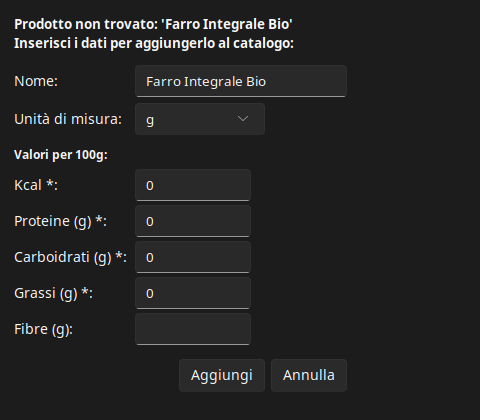
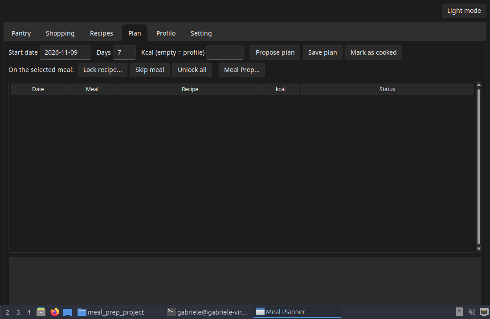
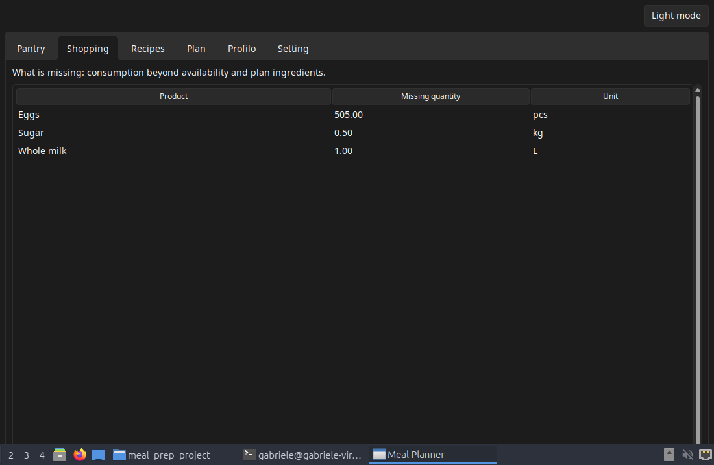
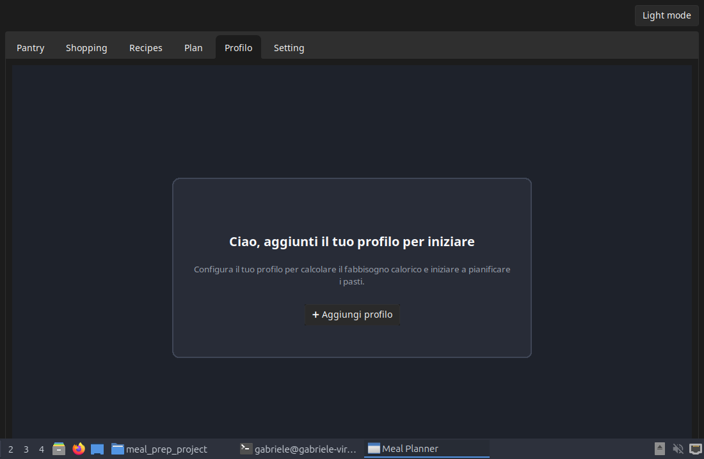
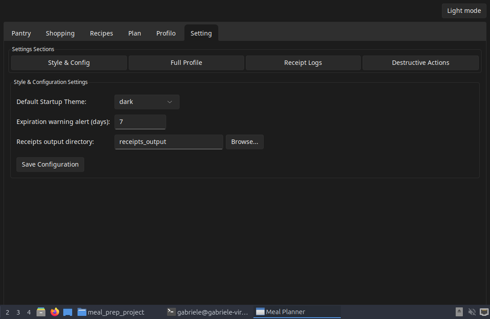
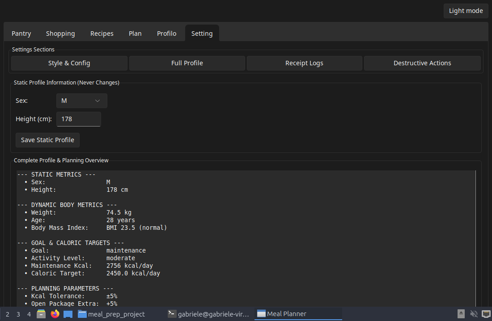
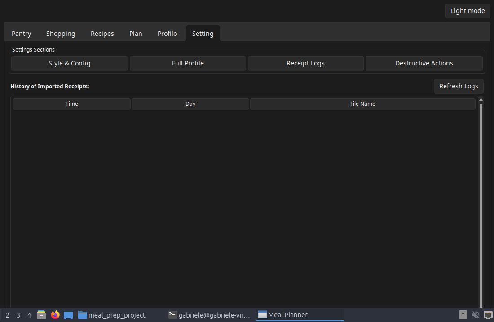

# Guida Completa al Funzionamento di Meal Planner

Benvenuto nel manuale operativo e architetturale di **Meal Planner**, l'applicazione desktop avanzata per la gestione intelligente della dispensa, la catalogazione delle ricette, l'acquisizione automatica degli scontrini e la pianificazione nutrizionale dei pasti a spreco zero.

---

## Indice dei Contenuti
1. [Architettura del Sistema e Avvio](#1-architettura-del-sistema-e-avvio)
2. [Gestione della Dispensa (Scheda Pantry)](#2-gestione-della-dispensa-scheda-pantry)
3. [Modifica di un Alimento e Disambiguazione Macro](#3-modifica-di-un-alimento-e-disambiguazione-macro)
4. [Acquisizione Scontrini e Riconciliazione Catalogo](#4-acquisizione-scontrini-e-riconciliazione-catalogo)
5. [Gestione Ricette e Creazione Interattiva (Scheda Recipes)](#5-gestione-ricette-e-creazione-interattiva-scheda-recipes)
6. [Registrazione di Prodotti al Volo](#6-registrazione-di-prodotti-al-volo)
7. [Pianificatore Alimentare Nutrizionale (Scheda Plan)](#7-pianificatore-alimentare-nutrizionale-scheda-plan)
8. [Lista della Spesa Intelligente (Scheda Shopping)](#8-lista-della-spesa-intelligente-scheda-shopping)
9. [Profilo Utente e Obiettivi Fisici (Scheda Profilo)](#9-profilo-utente-e-obiettivi-fisici-scheda-profilo)
10. [Impostazioni di Sistema e Configurazione (Scheda Setting)](#10-impostazioni-di-sistema-e-configurazione-scheda-setting)
11. [Gestione Temi Grafici (Dark Mode vs Light Mode)](#11-gestione-temi-grafici-dark-mode-vs-light-mode)
12. [Script di Utilità e Strumenti di Sviluppo](#12-script-di-utilità-e-strumenti-di-sviluppo)

---

## 1. Architettura del Sistema e Avvio

Meal Planner è concepito secondo i più rigorosi principi di **affidabilità**, **integrità dei dati** e **funzionamento al 100% offline**:
- **Database Centralizzato SQLite**: Tutti i dati (prodotti, alias, scorte fisiche, ricette, storico pesate, log scontrini e impostazioni applicative) risiedono all'interno dell'archivio unico [`data/inventory.db`](file:///home/gabriele/Desktop/meal_prep/meal_prep_project/data/inventory.db).
- **Zero File JSON Sparsi**: Tutte le configurazioni sono gestite all'interno della tabella relazionale `APP_SETTINGS`.
- **WAL Mode & Foreign Keys**: SQLite opera con Write-Ahead Logging (`PRAGMA journal_mode = WAL;`) per garantire massima concorrenza e prestazioni, e vincoli di integrità referenziale sempre attivi (`PRAGMA foreign_keys = ON;`).
- **Interfaccia Grafica**: Costruita con Python Tkinter e il tema moderno `sv-ttk`.

### Come avviare l'applicazione:
Dal terminale nella radice del progetto:
```bash
python -m meal_planner
```
Oppure specificando un database alternativo:
```bash
MEAL_PLANNER_DB=/percorso/mio_archivio.db python -m meal_planner
```

---

## 2. Gestione della Dispensa (Scheda Pantry)

La scheda **Pantry** rappresenta il cruscotto centrale delle scorte alimentari presenti in casa.


### Elementi Principali:
1. **Tabella Scorte dell'Inventario**:
   - Mostra tutti gli alimenti con le relative colonne: **Nome Alimento**, **Unità**, **Quantità Rimanente**, **Locazione** (`pantry`, `fridge`, `freezer`) e **Data di Scadenza**.
   - Gli alimenti vicini alla data di scadenza vengono evidenziati graficamente per prevenire lo spreco.
2. **Pulsante di Eliminazione Dedicato su Ogni Riga**:
   - All'estremità destra di ciascuna riga è presente un pulsante personalizzato raffigurante una **croce rosso scuro racchiusa in un quadrato stondato**.
   - Cliccando sul pulsante viene richiesta una conferma rapida per rimuovere la singola voce fisica dall'inventario, senza intaccare il catalogo generale dei prodotti o le ricette.
3. **Pannello delle Azioni Rapide**:
   - **Add to inventory**: Form rapido per inserire manualmente un alimento conosciuto.
   - **Consume**: Form per consumare una porzione o quantità specifica di un alimento.
   - **Locations**: Gestione e rinomina delle locazioni di stoccaggio.
4. **Area Drag & Drop per Scontrini**:
   - In basso a destra è presente una zona tratteggiata (*"Drag & drop receipt image or PDF here"*). Rilasciando un'immagine o file di scontrino, la pipeline OCR si attiva istantaneamente.

---

## 3. Modifica di un Alimento e Disambiguazione Macro

Facendo **doppio clic su qualsiasi riga dell'inventario**, si apre la finestra modale di modifica avanzata [`InventoryItemEditDialog`](file:///home/gabriele/Desktop/meal_prep/meal_prep_project/meal_planner/gui/dialogs.py).


### Caratteristiche Modificabili:
- **Dati Fisici di Scorta**: Nome, Peso unitario (es. 0.5 kg per pacco), Numero di confezioni integre, Rimanenza aperta, Locazione e Data di scadenza.
- **Parametri di Prodotto**: Unità di misura (`kg`, `g`, `L`, `ml`, `pcs`), Grammi per pezzo (per i prodotti venduti a unità), Densità in kg/L (per i liquidi).
- **Profilo Nutrizionale Completo (su 100g)**: Calorie (Kcal), Proteine, Carboidrati, Grassi, Zuccheri, Grassi Saturi, Fibre e Sale.

### Prompt di Scelta per la Propagazione dei Macronutrienti:
Se i valori nutrizionali modificati appartengono a un prodotto condiviso da più voci d'inventario o ricette, il sistema protegge la coerenza dell'archivio aprendo un prompt di decisione:


L'utente può scegliere tra due comportamenti espliciti:
1. **Modifica solo questo alimento specifico (Opzione 1)**: Crea un nuovo prodotto derivato nel catalogo e ri-collega solo l'alimento selezionato, lasciando invariate le altre voci d'inventario e ricette.
2. **Propaga la modifica a ritroso su tutte le istanze collegate (Opzione 2)**: Aggiorna il prodotto madre nel database, propagando i nuovi valori nutrizionali a ritroso su tutti gli alias e le ricette che contengono quell'alimento.

---

## 4. Acquisizione Scontrini e Riconciliazione Catalogo

Trascinando uno scontrino nell'area Drag & Drop o avviando la scansione, il sistema analizza il documento ed apre la finestra di **Riconciliazione Scontrini** ([`ReceiptReconciliationDialog`](file:///home/gabriele/Desktop/meal_prep/meal_prep_project/meal_planner/gui/dialogs.py)).


### Funzionalità della Riconciliazione:
- **Fuzzy Matching Intelligente**: Ogni dicitura dello scontrino (es. *"penne rigate 500g"*) viene confrontata con il catalogo alias esistente.
- **Revisione Rapida**: Per ciascun elemento l'utente può correggere il nome associato, selezionare l'unità, impostare la locazione desiderata e la data di scadenza.
- **Esclusione Voci Non Alimentari**: Voci spurie (es. buste della spesa, sconti, totali) possono essere deselezionate con un clic.
- **Inserimento Atomico a Scorte**: Cliccando su *"Import to Inventory"*, tutti gli alimenti validati vengono aggiunti atomicamente al database e registrati nello storico scontrini (`RECEIPT_LOGS`).

---

## 5. Gestione Ricette e Creazione Interattiva (Scheda Recipes)

La scheda **Recipes** permette di consultare l'elenco delle ricette disponibili e i loro macronutrienti per porzione.


Cliccando sul pulsante **"Add Recipe"**, si apre il builder visivo interattivo [`AddRecipeDialog`](file:///home/gabriele/Desktop/meal_prep/meal_prep_project/meal_planner/gui/dialogs.py).


### Come creare una ricetta:
1. Inserisci il **Nome della Ricetta** e imposta le **Porzioni di default**.
2. Seleziona i **Pasti Abilitati** spuntando una o più opzioni tra *Colazione (Breakfast)*, *Pranzo (Lunch)* e *Cena (Dinner)*.
3. Aggiungi gli ingredienti:
   - Seleziona un ingrediente dal menu o digitalo.
   - Indica la quantità e l'unità di misura (`g`, `kg`, `ml`, `L`, `pcs`, `tbsp`, `tsp`).
   - Se applicabile, spunta *"Quanto basta (To taste)"* per aromi o condimenti non calorici.
   - Clicca **"Add Ingredient"**: l'ingrediente compare nella tabella sottostante.
4. **Calcolo Macronutrienti in Tempo Reale**:
   - Il riquadro in basso a destra aggiorna all'istante le calorie totali, proteine, carboidrati e grassi per singola porzione.
5. Inserisci eventuali **Note di preparazione** e clicca **"Save Recipe"**.

---

## 6. Registrazione di Prodotti al Volo

Se durante la creazione di una ricetta (o la riconciliazione di uno scontrino) si digita un ingrediente non ancora presente nel catalogo, Meal Planner non blocca l'utente: compare automaticamente il popup [`QuickProductDialog`](file:///home/gabriele/Desktop/meal_prep/meal_prep_project/meal_planner/gui/dialogs.py).



### Campi Richiesti:
- **Unità Base**: Tipicamente `g` o `pcs`.
- **Valori Nutrizionali per 100g**: Calorie (Kcal), Proteine, Carboidrati, Grassi e Fibre.

Una volta confermato, il prodotto viene registrato nel database con ID univoco e diventa immediatamente utilizzabile nella ricetta e nelle future pianificazioni.

---

## 7. Pianificatore Alimentare Nutrizionale (Scheda Plan)

La scheda **Plan** implementa il motore matematico di composizione dei pasti.



### Principi dell'Algoritmo di Pianificazione:
1. **Rispetto del Fabbisogno Calorico e dei Macro**:
   - L'algoritmo distribuisce le calorie della giornata secondo le quote impostate (es. 25% Colazione, 40% Pranzo, 35% Cena) con una tolleranza configurabile (default ±5%).
2. **Priorità Confezioni Aperte (Zero Spreco)**:
   - Se in dispensa è presente una confezione già aperta (`Open_Remainder > 0`), l'algoritmo assegna la priorità assoluta alle ricette che la consumano fino a esaurimento prima di suggerire l'apertura di confezioni nuove.
3. **Finestra di Non-Ripetizione**:
   - Impedisce la riproposta della medesima ricetta entro una finestra temporale definita (default 3 giorni).
4. **Blocco Pasti Manuale (Locking)**:
   - L'utente può bloccare specifici pasti su una ricetta a piacere (es. pranzo della domenica) o saltare un pasto: il pianificatore adatterà gli altri pasti per riequilibrare i macronutrienti totali.
5. **Cottura Multi-Porzione e Avanzi (Leftovers)**:
   - Cucinando più porzioni di una ricetta, le porzioni in eccesso vengono contrassegnate automaticamente come "avanzi refrigerati" e proposte nei giorni successivi senza dover ri-acquistare gli ingredienti.

---

## 8. Lista della Spesa Intelligente (Scheda Shopping)

La scheda **Shopping** calcola in automatico le scorte mancanti incrociando l'inventario reale con il piano dei pasti.



- Se una ricetta pianificata necessita di 300g di riso e in dispensa ne rimangono 100g, la lista della spesa registra un ammanco di 200g.
- Il sistema raggruppa le mancanze per alimento e calcola il numero di confezioni integre da acquistare.
- All'arrivo della spesa (o all'importazione dello scontrino), la lista della spesa viene automaticamente scalata e aggiornata.

---

## 9. Profilo Utente e Obiettivi Fisici (Scheda Profilo)

La scheda **Profilo** accoglie i parametri fisiologici dinamici e gli obiettivi di benessere dell'utente.

### Stato Iniziale Non Configurato (Overlay Smussato):
All'avvio su un database nuovo, o dopo un reset, la schermata si presenta completamente pulita:



Un grande rettangolo con angoli arrotondati copre la vista visualizzando il testo:
> *"Ciao, aggiunti il tuo profilo per iniziare"*

### Profilo Configurato:
Compilando i propri dati, l'overlay scompare rivelando la schermata operativa completa:


- **Parametri Dinamici**: Peso corporeo, Livello di attività fisica (leggero, moderato, intenso) e Obiettivo (mantenimento, perdita o aumento peso).
- **Stime Metaboliche Automatiche**: Calcolo automatico del Metabolismo Basale (BMR), del fabbisogno di mantenimento calorico e del Caloric Target giornaliero.
- **Calcolo Indice di Massa Corporea (BMI)**: Indicazione del valore e della categoria (es. *Normopeso*).
- **Storico Ponderale e Grafico**: Tabella delle ultime pesate e grafico a linee interattivo che mostra l'evoluzione del peso nel tempo.

---

## 10. Impostazioni di Sistema e Configurazione (Scheda Setting)

La scheda **Setting** adotta una struttura a sezioni isolate, selezionabili dalla barra superiore:

### 10.1 Sezione Style & Configuration
Gestisce lo stile grafico e le preferenze globali dell'applicazione.



- **Default Startup Theme**: Selezione del tema con cui l'applicazione si avvia all'apertura (`dark` o `light`), salvato in modo permanente nel database.
- **Expiration warning alert (days)**: Giorni di preavviso per considerare un alimento in scadenza (default: 7 giorni).
- **Receipts output directory**: Cartella locale in cui vengono salvati i report e i file degli scontrini elaborati.

### 10.2 Sezione Full Profile
Riepiloga le metriche statiche e l'intero quadro nutrizionale dell'utente.



- **Campi Statici**: Permette di modificare **Sesso** e **Altezza** (parametri che non variano con le pesate).
- **Quadro Globale**: Riepilogo formattato in sola lettura contenente metriche fisiche, obiettivi calorici, tolleranze, giorni di non-ripetizione e ripartizione calorica dei pasti (`Colazione`, `Pranzo`, `Cena`). Se nessun profilo è presente, i campi rimangono rigorosamente vuoti (`""`) e viene mostrato un avviso esplicativo.

### 10.3 Sezione Receipt Logs
Permette di consultare la cronologia di tutti gli scontrini acquisiti.



- Tabella con **Orario di scansione**, **Giorno** e **Nome File** del documento elaborato.
- Pulsante *"Refresh Logs"* per aggiornare istantaneamente la tabella.

### 10.4 Sezione Destructive Actions (Danger Zone)
Pannello protetto per operazioni ad alto impatto.


- **Hard-Delete Entire Inventory**: Cancella in modo permanente tutte le scorte fisiche dalla tabella `INVENTORY`. Ricette, prodotti di catalogo e alias vengono conservati.
- **Reset User Profile**: Azzera completamente il profilo utente, le preferenze e lo storico delle pesate, riportando l'applicazione allo stato iniziale pulito.
- **Guardrail di Sicurezza**: Ogni pulsante richiede una conferma modale esplicita (`askyesno`) prima di eseguire l'operazione.

---

## 11. Gestione Temi Grafici (Dark Mode vs Light Mode)

Meal Planner supporta nativamente sia la modalità scura ad alto contrasto che la modalità chiara rilassante.


### Due Livelli di Controllo:
1. **Scelta di Default all'Avvio (Settings)**:
   - Configurata nella scheda Setting: garantisce che ogni volta che apri il programma venga caricato il tema desiderato.
2. **Switch Temporaneo in Tempo Reale (Header Button)**:
   - Cliccando sul pulsante rapido in alto a destra (*"Light mode"* / *"Dark mode"*), l'applicazione commuta istantaneamente la palette di colori (tabelle, grafici, campi di testo, canvas) **per la sessione corrente**, senza alterare la preferenza di default salvata nel database.

---

## 12. Script di Utilità e Strumenti di Sviluppo

Il progetto include script dedicati nella cartella `scripts/` per automatizzare l'inizializzazione dell'ambiente, la verifica dell'integrità del database, l'esecuzione della suite di test e le dimostrazioni funzionali:

### 12.1 `scripts/setup_project.py`
Script principale per la configurazione del database e la validazione del sistema:
- **Inizializzazione automatica**: crea il database `data/inventory.db` e il symlink relativo se assenti, esegue le migrazioni dello schema e verifica l'integrità referenziale.
- **Verifica dei test**:
  ```bash
  python scripts/setup_project.py --test
  ```
  Esegue tutte le 6 suite tematiche di test in processi isolati e su database temporanei, stampando il riepilogo di conformità.
- **Ripristino dati demo**: `python scripts/setup_project.py --reset -y` ripulisce e ricarica i dati dimostrativi di base.

### 12.2 `scripts/demo_receipt.py`
Launcher unificato per verificare e dimostrare il funzionamento della pipeline OCR e riconciliazione degli scontrini:
- **Modalità Drag & Drop (default / `--drop`)**:
  ```bash
  python scripts/demo_receipt.py --drop
  ```
  Avvia l'interfaccia grafica e simula automaticamente dopo 1.2 secondi il rilascio del file scontrino mock `mock_data/mock_receipt.png` sulla drop zone della scheda Pantry.
- **Modalità Riconciliazione Diretta (`--reconcile`)**:
  ```bash
  python scripts/demo_receipt.py --reconcile
  ```
  Apre direttamente la finestra modale di riconciliazione `ReceiptReconciliationDialog` popolata con 7 voci di test (prodotti riconosciuti e non riconosciuti), permettendo di testare immediatamente l'inserimento in dispensa e la definizione di nuovi prodotti.
